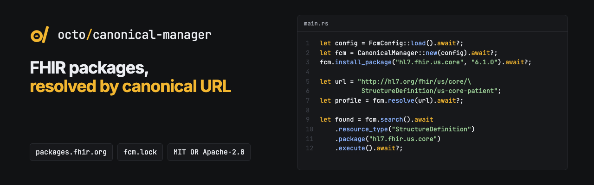

<p align="center"></p>

<p align="center"><b>Install FHIR Implementation Guide packages, then resolve and search their resources by canonical URL.</b></p>

<p align="center">
  <a href="https://github.com/octofhir/canonical-manager-rs/actions/workflows/ci.yml"></a>
  <a href="https://crates.io/crates/octofhir-canonical-manager"></a>
  <a href="https://docs.rs/octofhir-canonical-manager"></a>
  <a href="#license"></a>
</p>

A library-first solution for managing FHIR Implementation Guide packages, providing fast canonical URL resolution and resource search capabilities.

## Features

- 📦 **Package Management**: Install, update, and remove FHIR packages from registries
- 🔍 **Fast Resolution**: canonical URL resolution backed by SQLite B-tree indexes
- 🔎 **Advanced Search**: Query FHIR resources by type, package, and other criteria
- 🔧 **Search Parameters**: Retrieve FHIR SearchParameter definitions by resource type
- 🗄️ **Flexible Storage**: SQLite backend (optional) or bring your own storage implementation
- 🏗️ **Library First**: Clean trait-based API for embedding in your applications
- 🖥️ **CLI Tool**: Optional command-line interface for interactive use
- 🌐 **Registry Support**: Compatible with standard FHIR package registries
- ⚡ **Async/Await**: Built with modern async Rust for performance
- 🔄 **Multi-Version**: Support multiple FHIR versions simultaneously
- 📁 **Local Packages**: Load packages from local directories

## Cargo Features

This crate supports several optional features:

- **`sqlite`** (enabled by default through `cli`): Enables SQLite storage backend
  - Provides `SqliteStorage` implementation
  - Required for `CanonicalManager::new()` and `UnifiedStorage::new()`
  - If disabled, you must provide your own storage via trait implementations

- **`cli`** (included in default): Enables the command-line interface
  - Automatically enables the `sqlite` feature
  - Provides the `octofhir-fcm` binary and its panic reporting and tracing setup

- **`fuzzy-search`**: Enables fuzzy matching for canonical URL resolution
- **`metrics`**: Enables performance metrics collection

### Default Features

The default feature set is `cli`, which also enables `sqlite`. To use the library without SQLite:

```toml
[dependencies]
octofhir-canonical-manager = { version = "0.2", default-features = false }
```

To use with only the SQLite storage (no CLI):

```toml
[dependencies]
octofhir-canonical-manager = { version = "0.2", default-features = false, features = ["sqlite"] }
```

## Quick Start

### Library Usage

Add to your `Cargo.toml`:

```toml
[dependencies]
octofhir-canonical-manager = "0.2"
tokio = { version = "1.0", features = ["full"] }
```

Basic usage:

```rust
use octofhir_canonical_manager::{CanonicalManager, FcmConfig};

#[tokio::main]
async fn main() -> Result<(), Box<dyn std::error::Error>> {
    // Load configuration
    let config = FcmConfig::load().await?;
    let manager = CanonicalManager::new(config).await?;
    
    // Install a FHIR package
    manager.install_package("hl7.fhir.us.core", "6.1.0").await?;
    
    // Resolve a canonical URL
    let resolved = manager.resolve(
        "http://hl7.org/fhir/us/core/StructureDefinition/us-core-patient"
    ).await?;
    
    println!(
        "Found {}/{} in {}",
        resolved.resource.resource_type, resolved.resource.id, resolved.package_info.name
    );
    
    // Search for resources (search() is async and returns a query builder)
    let results = manager.search()
        .await
        .resource_type("StructureDefinition")
        .package("hl7.fhir.us.core")
        .execute()
        .await?;
        
    println!("Found {} structure definitions", results.total_count);
    
    // Get search parameters for a resource type
    let search_params = manager.get_search_parameters("Patient").await?;
    println!("Found {} search parameters for Patient", search_params.len());
    
    Ok(())
}
```

### Custom Storage Backend

If you want to use a different storage backend (PostgreSQL, MongoDB, etc.), you can implement the `PackageStore` and `SearchStorage` traits:

```rust
use octofhir_canonical_manager::{
    CanonicalManager, FcmConfig,
    PackageStore, SearchStorage,
};
use std::sync::Arc;

// Implement the PackageStore trait for your storage
struct MyPostgresStorage {
    // Your storage fields
}

#[async_trait::async_trait]
impl PackageStore for MyPostgresStorage {
    // Implement required methods
    async fn add_package(&self, package: &ExtractedPackage) -> Result<()> {
        // Your implementation
    }

    async fn remove_package(&self, name: &str, version: &str) -> Result<bool> {
        // Your implementation
    }

    async fn find_resource(&self, canonical_url: &str) -> Result<Option<ResourceIndex>> {
        // Your implementation
    }

    async fn list_packages(&self) -> Result<Vec<PackageInfo>> {
        // Your implementation
    }
}

#[async_trait::async_trait]
impl SearchStorage for MyPostgresStorage {
    // Implement required methods
    // See trait definition for all required methods
}

#[tokio::main]
async fn main() -> Result<(), Box<dyn std::error::Error>> {
    let config = FcmConfig::default();
    let storage = Arc::new(MyPostgresStorage::new());
    let registry = Arc::new(MyCustomRegistry::new());

    let manager = CanonicalManager::new_with_components(
        config,
        storage.clone(),  // PackageStore
        registry,          // AsyncRegistry
        storage,           // SearchStorage
    ).await?;

    // Use manager as normal
    Ok(())
}
```

### CLI Usage

Install the CLI tool:

```bash
cargo install octofhir-canonical-manager --features cli
```

Initialize and use:

```bash
# Initialize configuration
octofhir-fcm init

# Install packages
octofhir-fcm install hl7.fhir.us.core@6.1.0

# Search resources
octofhir-fcm search "Patient" --resource-type StructureDefinition

# Get search parameters for a resource type
octofhir-fcm search-params Patient
octofhir-fcm search-params Patient --format json
octofhir-fcm search-params Patient --format csv

# Resolve canonical URLs
octofhir-fcm resolve "http://hl7.org/fhir/us/core/StructureDefinition/us-core-patient"

# List installed packages
octofhir-fcm list
```

## Configuration

Create a `fcm.toml` configuration file:

```toml
[registry]
url = "https://packages.fhir.org"
timeout = 60
retry_attempts = 5

[[packages]]
name = "hl7.fhir.r4.core"
version = "4.0.1"
priority = 1

[storage]
cache_dir = ".fcm/cache"
packages_dir = ".fcm/packages"
max_cache_size = "2GB"

# Optimization settings (SQLite handles indexing automatically)
[optimization]
# Parallel processing
parallel_workers = 8
batch_size = 100

# Change detection
enable_checksums = true
checksum_algorithm = "blake3"
checksum_cache_size = 10000

# Performance monitoring
enable_metrics = true
metrics_interval = "30s"
```

### Configuration Options

#### Registry Settings
- `url`: FHIR package registry URL (NPM package spec; default `https://packages.fhir.org`)
- `fallbacks`: Registries tried when the primary fails (default `["https://packages2.fhir.org/packages"]`)
- `[[registry.extra]]`: Additional non-NPM registries (for example `fs.get-ig.org`) with `client_type = "tarball-direct"` or `"s3-flat"`
- `timeout`: Network timeout in seconds
- `retry_attempts`: Number of retry attempts for failed requests

#### Storage Settings
- `cache_dir`: Directory for package downloads cache
- `packages_dir`: Directory for extracted packages
- `max_cache_size`: Maximum cache size (e.g., "2GB", "500MB")

#### Optimization Settings
- `parallel_workers`: Number of workers for parallel package processing
- `batch_size`: Batch size for parallel operations
- `enable_checksums`: Enable package checksum validation for change detection
- `checksum_algorithm`: Algorithm to use (`blake3`, `sha256`, `sha1`)
- `checksum_cache_size`: Size of checksum cache
- `enable_metrics`: Enable performance metrics collection
- `metrics_interval`: Metrics collection interval

**Note**: SQLite handles indexing, compression, and memory mapping automatically - no manual configuration needed!

## API Overview

### Core Types

- **`CanonicalManager`**: Main entry point for all operations
- **`FcmConfig`**: Configuration management
- **`CanonicalResolver`**: Fast URL resolution engine
- **`SearchEngine`**: Advanced resource search capabilities
- **`SqliteStorage`**: SQLite-based storage with automatic indexing

### Key Methods

```rust
// Package management
manager.install_package("package-name", "version").await?;
manager.remove_package("package-name", "version").await?;
manager.list_packages().await?; // Vec<String> of "name@version"

// Batch installation (optimized for multiple packages)
manager.install_packages_batch(packages).await?; // Vec<PackageSpec>

// Resource resolution
let resource = manager.resolve("canonical-url").await?;
let resources = manager.batch_resolve(&urls).await?;

// Resolution with FHIR version
let resource = manager.resolve_with_fhir_version(
    "http://hl7.org/fhir/StructureDefinition/Patient",
    "4.0.1"
).await?;

// Search functionality
let results = manager.search()
    .await
    .resource_type("StructureDefinition")
    .package("hl7.fhir.us.core")
    .canonical_pattern("Patient")
    .execute()
    .await?;
for found in &results.resources {
    println!("{}", found.resource.id);
}

// Search parameter retrieval
let search_params = manager.get_search_parameters("Patient").await?;
for param in search_params {
    println!("{}: {} ({})", param.code, param.name, param.type_field);
}

// Load local packages
manager.load_from_directory(Path::new("/path/to/package"), Some("my.package@1.0.0")).await?;
manager.load_resources_from_directory(Path::new("/path/to/resources"), "my.namespace").await?;
```

## CLI Commands

| Command | Description |
|---------|-------------|
| `init` | Initialize FCM configuration |
| `install <package>[@version]` | Install FHIR package |
| `remove <package>[@version]` | Remove FHIR package |
| `list` | List installed packages |
| `search <query>` | Search for resources |
| `search-params <resource-type>` | Get search parameters for a resource type |
| `resolve <url>` | Resolve canonical URL |
| `update` | Update package indexes |
| `config` | Manage configuration |
| `store` | Inspect, verify, and clean the content-addressable store (`path`, `verify`, `gc`, `prune`) |
| `materialize` | Materialise installed packages into `<cwd>/.fcm/modules/` |
| `lock` | Write or refresh `fcm.lock` in the current directory |

## Performance

The canonical manager is optimized for speed and reliability:

### SQLite Backend Benefits
- **B-tree Indexes**: indexed canonical URL lookups without manual index management
- **WAL Mode**: Write-Ahead Logging for better concurrency and crash recovery
- **Single-Query Joins**: Eliminates separate package lookups for faster resolution
- **Atomic Transactions**: Ensures data consistency across operations
- **Automatic Optimization**: SQLite handles compression, memory mapping, and index maintenance

### Additional Optimizations
- **Batch Installation**: Install N packages with single index rebuild instead of N rebuilds
- **Streaming Downloads**: Efficient package downloads with progress tracking
- **Change Detection**: Blake3 checksums for fast package change detection
- **Parallel Processing**: Configurable worker threads for package extraction
- **Dependency Resolution**: Automatic handling of package dependencies
- **Smart Caching**: Minimizes network requests and disk I/O

### Benchmarks
Criterion benchmarks live in [`benches/`](benches/) (resolve, search, install, lockfile,
CAS, tar extraction and more); run them with `cargo bench`.

## Architecture

### Storage Layer
- **SqliteStorage**: Industry-standard SQLite database with:
  - B-tree indexes for fast lookups
  - JSON storage for flexible resource data
  - WAL mode for concurrency
  - Atomic transactions for consistency

### Resolution Strategies
1. **Exact Match**: Direct B-tree index lookup (fastest)
2. **Version Fallback**: Find latest version of base URL
3. **Fuzzy Matching**: trigram index over canonical URLs for typo tolerance (`fuzzy-search` feature)

### Search Capabilities
- Full-text search with inverted text index
- Filter by resource type, package, URL patterns
- Faceted search with relevance scoring
- SearchParameter resource queries

## Development

```bash
# Run tests
just test

# Check code quality
just check

# Fix formatting and linting
just fix-all

# Prepare for publishing
just prepare-publish

# Generate documentation
just docs

# Run examples
cargo run --example search_parameters
cargo run --example configuration
```

## Examples

See the [examples](examples/) directory for more usage examples:
- `basic_usage.rs`: Basic package management and resolution
- `package_management.rs`: Installing, listing and removing packages
- `advanced_search.rs`: Search queries and filters
- `search_parameters.rs`: Working with FHIR SearchParameters
- `configuration.rs`: Configuration management

## License

Licensed under either of:

- Apache License, Version 2.0 ([LICENSE-APACHE](LICENSE-APACHE))
- MIT License ([LICENSE-MIT](LICENSE-MIT))

at your option.

## Contributing

Contributions are welcome! Please see [CONTRIBUTING.md](CONTRIBUTING.md) for guidelines.

## Links

- [Documentation](https://docs.rs/octofhir-canonical-manager)
- [Crates.io](https://crates.io/crates/octofhir-canonical-manager)
- [Repository](https://github.com/octofhir/canonical-manager-rs)
- [Issue Tracker](https://github.com/octofhir/canonical-manager-rs/issues)

---

Made with ❤️ by OctoFHIR Team 🐙🦀
